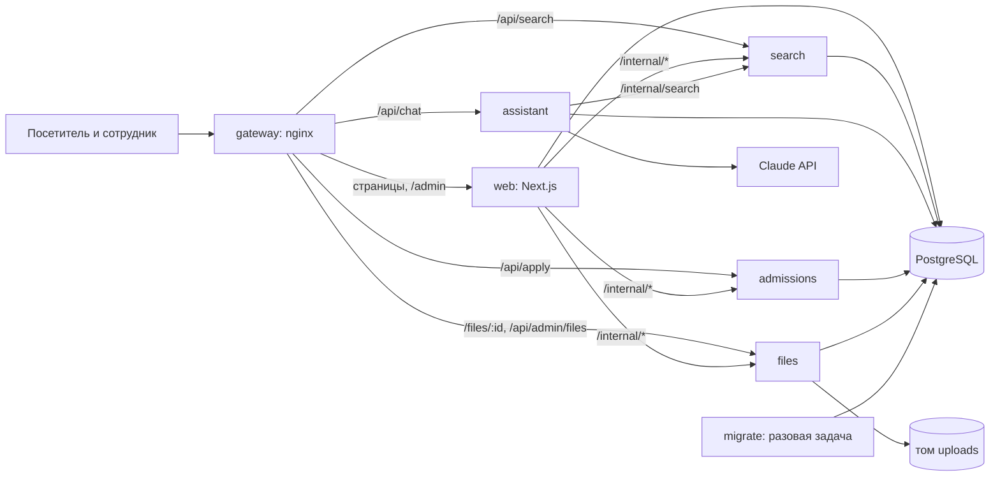
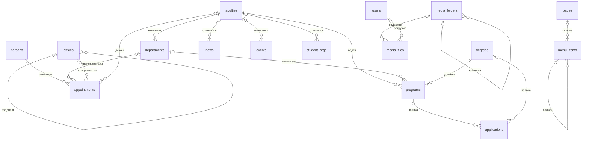

# Архитектура

## Общая схема



## Сервисы

| Сервис | За что отвечает | Таблицы (запись) | Только чтение |
| --- | --- | --- | --- |
| `gateway` | Единственный опубликованный порт, маршрутизация, лимит размера запроса | нет доступа к базе | |
| `web` | Страницы сайта, панель, вход, контент, меню, настройки, пользователи | контент, `menu_items`, `site_settings`, `users` | |
| `search` | Поиск и индекс | `search_documents` | контент |
| `assistant` | ИИ-помощник, единственный держатель ключа Claude API | | `site_settings` |
| `files` | Хранилище, загрузка, выдача с проверкой доступа, папки | `media_files`, `media_folders` | `users.id` |
| `admissions` | Приём и обработка заявок | `applications` | `programs`, `degrees` |
| `migrate` | Схема, роли, первый администратор, демо-контент. Выполняется и завершается | владелец базы | |

**База одна, роли разные.** Внешние ключи связывают данные разных сервисов (например, заявка ссылается на программу,
новость на картинку), и отдельные базы лишили бы их этой проверки. Поэтому у каждого сервиса своя роль PostgreSQL с правами
только на свои таблицы: в заявки нельзя заглянуть из `web`, а `files` видит у пользователей только `id`. Права описаны
в `src/db/roles.ts`, и `migrate` приводит их к этому описанию при каждом запуске. Новой таблице нужна запись в этом файле.

**Вызовы между сервисами.** Обычный HTTP к адресам `/internal/*` с токеном `INTERNAL_TOKEN`. Шлюз эти адреса не публикует.
Клиент для `web` лежит в `src/lib/services.ts`. Подпись сессии `web` и `files` проверяют общим кодом `src/lib/session.ts`.

**Сети.** `edge` для опубликованного порта и выхода в интернет, `mesh` для вызовов между сервисами, `data` для базы.
`mesh` и `data` изолированы от внешнего мира. В `edge` кроме шлюза подключён только `assistant`, потому что ему нужен Claude API.
Шлюз не подключён к `data` и базу не видит.

**Что происходит при отказе.** Падение сервиса не роняет остальной сайт.

| Не работает | Что видит человек |
| --- | --- |
| `search` | Подсказки и страница поиска сообщают о недоступности, чат отвечает без материалов сайта. Записи в панели сохраняются, индекс догоняет их при старте сервиса и каждые 10 минут (`REINDEX_INTERVAL_MINUTES`) |
| `assistant` | В чате сообщение об ошибке |
| `files` | Картинки и «Документы» недоступны, раздел «Файлы» в панели показывает ошибку |
| `admissions` | Форма заявки показывает ошибку и сохраняет введённое, раздел «Заявки» в панели показывает ошибку |
| `web` | Страница «временно недоступен» на трёх языках; поиск и заявки как API продолжают работать |

## Ключевые решения

**Многоязычность.** Адрес всегда начинается с языка. `proxy.ts` выбирает язык по cookie, затем по заголовку браузера.
Интерфейсные строки лежат в `src/i18n/{kk,ru,en}.ts`; тип `Dictionary` не даст забыть перевод.
Контент хранится в JSONB-полях вида `{"kk": "...", "ru": "...", "en": "..."}`: одна запись остаётся одной сущностью,
а добавление поля не требует отдельной таблицы переводов. Если перевода нет, `tr()` показывает текст на другом языке.

**Единая модель людей.** Преподаватели, специалисты, деканы и руководство лежат в одной таблице `persons`.
Роль и подразделение задаёт таблица `appointments`, поэтому один человек может быть деканом и профессором кафедры
одновременно. Ограничение `appointments_target_check` в базе не даёт сохранить, например, преподавателя без кафедры.

**Единый поисковый индекс.** Все публикуемые сущности при сохранении попадают в `search_documents` на трёх языках.
Индекс используют поиск по сайту, sitemap и ИИ-помощник. Для русского и английского работает стемминг, для казахского
конфигурация `simple` с поиском по началу слова. Опечатки ловит `pg_trgm`.

**Конфигурируемая админка.** Формы и списки строятся из описания полей в `src/admin/resources.ts`.
Новый раздел контента требует таблицы, записи в этом файле и публичных страниц; писать CRUD заново не нужно.

**Конструктор.** Страницы (`pages`) имеют произвольный адрес и отдаются маршрутом `[...slug]`. Адреса встроенных разделов
заняты (`RESERVED_PATHS`). Пункт меню (`menu_items`) ведёт на раздел, страницу или ссылку либо служит группой.

**Файловая система.** Папки образуют дерево (`media_folders`), файлы (`media_files`) лежат на томе под именем-UUID,
поэтому имя из загрузки не попадает в путь. Папка имеет два признака: `is_public` (файлы доступны без входа)
и `listed` (видна в разделе «Документы»). Файлы вне папок публичны: это картинки для страниц.

## Схема данных



Удаление факультета, у которого есть кафедры или программы, запрещено на уровне базы, и панель показывает понятное сообщение.
Изображения подключены через `image_id` с `ON DELETE SET NULL`: удаление файла не ломает страницу, появляется фирменная обложка.

## Безопасность

- Сессия: подписанный JWT в `httpOnly` cookie. Роль проверяется в каждом серверном действии, а не только в интерфейсе.
- Роли: администратор (всё) и редактор (контент, файлы, меню, заявки; без настроек и пользователей).
- HTML из редактора очищается при сохранении (`src/lib/sanitize.ts`).
- Загрузка: белый список расширений, до 50 МБ. SVG и прочие активные типы отдаются только на скачивание, с CSP `sandbox`.
- Лимиты запросов на вход, заявки, поиск и чат. Заявки защищены скрытым полем от ботов и хранят время согласия на обработку данных.
- Чат: контент сайта передаётся модели как данные, а не как инструкции. Ответ отображается как текст, ссылки только относительные или https.

## Известные ограничения при масштабировании

Лимиты запросов считаются в памяти каждого контейнера, файлы лежат на томе одного хоста. Чтобы запустить несколько экземпляров
сервиса, понадобятся общее хранилище лимитов (например, Redis, замена `src/lib/rate-limit.ts`) и общее файловое хранилище
(замена `services/files/storage.ts`). Плановая переиндексация запускается в каждом экземпляре `search`.

## Структура каталогов

```
gateway/                конфигурация nginx
services/
  search/               поиск и индекс
  assistant/            ИИ-помощник
  files/                хранилище и выдача файлов
  admissions/           заявки
  shared/               каркас сервиса, /health, проверка внутреннего токена
src/
  app/(site)/[locale]/  публичные страницы
  app/admin/            панель управления
  admin/                описание разделов, серверные действия
  components/site/      компоненты сайта
  components/admin/     компоненты панели
  db/                   схема, миграции, роли, наполнение
  i18n/                 переводы интерфейса
  lib/                  запросы, клиент сервисов, авторизация
scripts/                сборка сервисов, создание .env
```
